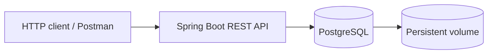

# Streaming Movies Cloud Backend

A Java/Spring Boot REST API for managing movies and TV series, backed by PostgreSQL and packaged for **Docker**, **Docker Compose**, and **Kubernetes (Minikube)**. Built as an academic cloud-computing project and prepared as a backend/cloud portfolio example.

## Tech stack

- **Backend:** Java 21, Spring Boot 4.0.6, Spring MVC, Spring Data JPA / Hibernate, Jakarta Validation
- **Database:** PostgreSQL 16
- **Build:** Maven (wrapper included)
- **Containers:** Docker (multi-stage Dockerfile), Docker Compose
- **Orchestration:** Kubernetes, Minikube; Deployment, StatefulSet, Services, ConfigMap, Secret, PV/PVC

## Architecture



The same backend can run locally, as two Docker containers, with Docker Compose, or on a local Kubernetes cluster. The API runs on port **8080**; PostgreSQL is reachable internally on port **5432**.

## Features

- Create, retrieve, update, delete, and search movies/TV series
- Validation for IDs, titles, director, release year, duration, genres, language, rating, seasons, and rental price
- Unique movie ID and unique title/year/director combination
- Structured HTTP errors for invalid data, duplicates, and missing entries
- Seed records on startup: *Blade Runner*, *The Matrix*, and *Breaking Bad*
- PostgreSQL persistence across container restarts using volumes
- Kubernetes readiness/liveness probes and resource limits

## API endpoints

| Method | Endpoint | Behavior |
| --- | --- | --- |
| `GET` | `/api/movies` | List all movies/series |
| `GET` | `/api/movies/{code}` | Get a record by its unique code |
| `GET` | `/api/movies/search?q=...` | Search across record fields |
| `POST` | `/api/movies` | Create a new record |
| `PUT` | `/api/movies/{code}` | Update mutable fields |
| `DELETE` | `/api/movies/{code}` | Remove a record |

Typical responses include `200 OK`, `201 Created`, `204 No Content`, `400 Bad Request`, `404 Not Found`, and `409 Conflict`.

Example create request:

```http
POST /api/movies
Content-Type: application/json
```

```json
{
  "code": "MOVIE00003",
  "title": "Interstellar",
  "director": "Christopher Nolan",
  "productionYear": 2014,
  "durationMinutes": 169,
  "genres": ["Sci-fi", "Drama"],
  "originalLanguage": "English",
  "rating": 8.7,
  "seasons": 0,
  "rentalCost": 4.99
}
```

The API accepts only the configured genres: Action, Comedy, Drama, Horror, Thriller, Romance, Animation, Documentary, Sci-fi and Fantasy. The `PUT` request updates duration, genres, original language, rating, seasons and rental cost; code, title, director and production year remain immutable.

## Quick start: Docker Compose (recommended)

**Requirements:** Docker Desktop / Docker Engine with Compose.

1. Copy `.env.example` to `.env` and replace `DB_PASSWORD` with your own local password. (`.env` is ignored by Git.)
2. From the repository root, run:

```shell
docker compose up --build -d
docker compose ps
```

3. Open [http://localhost:8080/api/movies](http://localhost:8080/api/movies).
4. Stop the stack with:

```shell
docker compose down
```

The named volume survives `docker compose down`; **`docker compose down -v` also deletes the database volume/data**. If you change the DB credentials on an existing initialized volume, recreate the volume or update the database user accordingly.

## Docker without Compose (Windows batch scripts)

These scripts create two containers, a user-defined Docker network and a named PostgreSQL volume. First set a password in your *PowerShell* session, then run:

```powershell
$env:DB_PASSWORD = 'YOUR_LOCAL_PASSWORD'
.\setup.bat
.\start.bat
docker ps
# Test http://localhost:8080/api/movies
.\stop.bat
```

`setup.bat` builds the REST API image and creates the network and volume; `start.bat` waits for PostgreSQL health before starting the API; `stop.bat` removes the containers/network but preserves the volume.

## Kubernetes (Minikube)

**Requirements:** Docker Desktop, `minikube`, `kubectl`. The Kubernetes manifest definitions are in [`yaml/`](yaml/).

Start the Minikube cluster, then create the PostgreSQL Secret *locally* (never commit live credentials):

```powershell
minikube start --driver=docker --memory=4096 --cpus=2
Copy-Item k8s-secret.env.example k8s-secret.env
# Edit k8s-secret.env and set a local PostgreSQL password
kubectl create secret generic postgres-secret --from-env-file=k8s-secret.env
```

Then run:

```powershell
docker build -t streamingmovies-api:1.0 .
minikube image load streamingmovies-api:1.0
kubectl apply -f yaml
kubectl get pods
kubectl get svc
kubectl get pv,pvc
```

**Important:** Select the Minikube context if you have multiple Kubernetes clusters (`kubectl config current-context`). The included `yaml/02-secret.yaml.example` documents the Secret format, but is **not applied automatically**.

After the pods become Ready, open another terminal:

```shell
kubectl port-forward service/movies-api-service 8080:8080
```

Browse to [http://localhost:8080/api/movies](http://localhost:8080/api/movies). Press `Ctrl+C` to stop port-forwarding. When finished:

```shell
kubectl delete -f yaml
kubectl delete secret postgres-secret
minikube stop
```

The PV is configured with `Retain`, but deletion of a PVC or Minikube cluster can still cause data loss or require manual recovery. The `hostPath` storage is for **local experimentation only**, not production.

## Local Java development

Install JDK **21+**, with Java 21 as the project's target, and start a PostgreSQL instance. Set `DB_URL`, `DB_USERNAME`, and `DB_PASSWORD` in the environment as appropriate; by default the JDBC URL points to `localhost:5432/moviesdb`.

```powershell
$env:DB_URL = 'jdbc:postgresql://localhost:5432/moviesdb'
$env:DB_USERNAME = 'moviesuser'
$env:DB_PASSWORD = 'YOUR_LOCAL_PASSWORD'
.\mvnw.cmd spring-boot:run
```

The existing `data.sql` seeds sample data and uses conflict-safe inserts. JPA/Hibernate creates/updates tables using `ddl-auto=update` in this development configuration.

## Repository layout

```text
src/main/java/           Spring Boot controllers, DTOs, entities, repository and service
src/main/resources/      application.properties and seed data.sql
src/test/                Java test sources
yaml/                    Kubernetes manifests (plus a non-applied Secret example)
Dockerfile               Multi-stage API image build
docker-compose.yml       API + PostgreSQL stack with health checks
setup.bat                Build image and create network/volume
start.bat                Run API and PostgreSQL without Compose
stop.bat                 Remove standalone containers/network
.env.example             Docker Compose environment template
k8s-secret.env.example   Local Kubernetes Secret template
```

## Security and scope

This repository is a **learning/demo project**, not a production-ready streaming platform. Never expose `.env`, `k8s-secret.env`, real database passwords or private keys to Git. Kubernetes Secret values are not encrypted merely because they can be base64 encoded. The examples use local-only credentials and single-instance PostgreSQL. The Spring Boot API does not provide user authentication or content streaming.

## Notes

Developed for a cloud-computing coursework project, with the focus on REST APIs, persistent databases, containerisation, and Kubernetes orchestration. No license has been selected for this portfolio repository.
